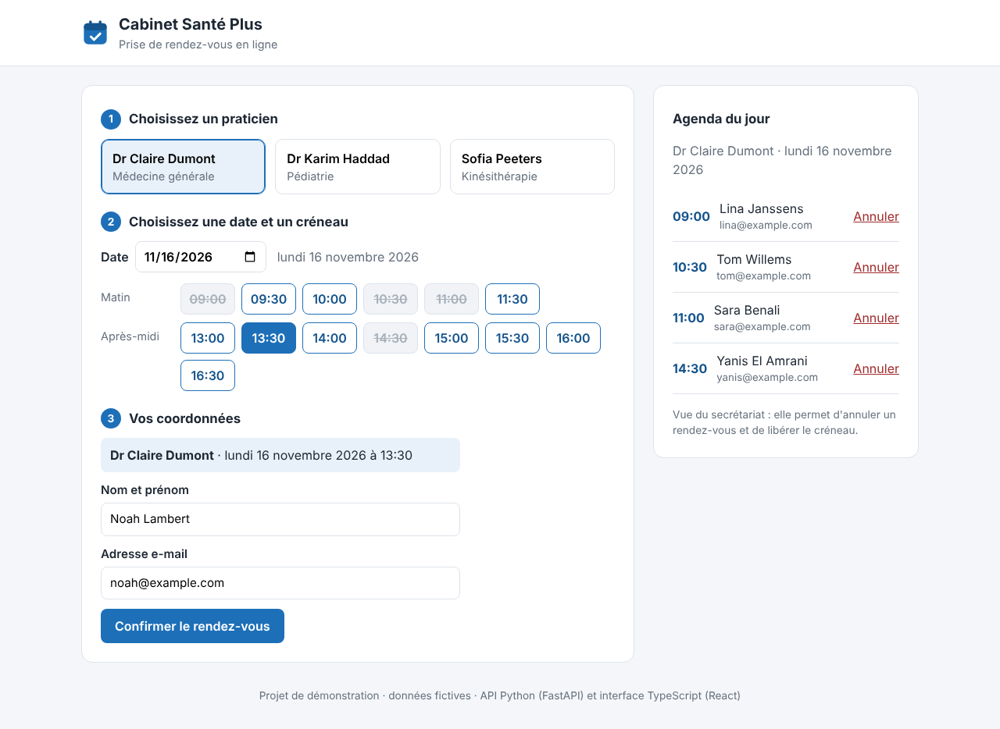

# Cabinet Santé Plus – prise de rendez-vous (FastAPI + React)

Application web de prise de rendez-vous pour un cabinet médical fictif. Elle se compose d'une **API REST en Python (FastAPI)** et d'une **interface en TypeScript (React)**.



## Fonctionnalités

- Choix d'un praticien, d'une date et d'un créneau de 30 minutes
- Réservation avec vérification du formulaire (nom, adresse e-mail)
- Agenda du jour de chaque praticien, avec annulation (vue du secrétariat)
- Règles du cabinet appliquées par l'API :
  - ouverture du lundi au vendredi, de 9 h à 12 h et de 13 h à 17 h ;
  - pas de réservation dans le passé ;
  - jamais deux rendez-vous sur le même créneau, garanti jusque dans la base de données par un index unique, même si deux personnes réservent au même moment ;
  - une annulation libère le créneau, qui peut être réservé à nouveau.

## Architecture

```
backend/                API REST en Python
  app/main.py           routes HTTP (FastAPI)
  app/services.py       règles métier, indépendantes du web
  app/models.py         tables de la base (SQLAlchemy 2, SQLite)
  app/schemas.py        validation des données entrantes et sortantes (Pydantic)
  tests/                20 tests automatiques (pytest)
frontend/               interface en TypeScript
  src/api.ts            appels typés à l'API
  src/components/       composants React : praticiens, créneaux, formulaire, agenda
  src/utils.ts          fonctions utilitaires, testées avec Vitest
```

L'interface et l'API sont deux applications séparées. En développement, le serveur Vite redirige les appels `/api` vers l'API, qui tourne sur le port 8000.

## Routes de l'API

| Méthode | Route | Rôle |
| --- | --- | --- |
| GET | `/api/practitioners` | Liste des praticiens |
| GET | `/api/practitioners/{id}/slots?day=AAAA-MM-JJ` | Créneaux d'une journée et leur disponibilité |
| GET | `/api/appointments?practitioner_id={id}&day=AAAA-MM-JJ` | Rendez-vous actifs d'une journée |
| POST | `/api/appointments` | Réserver un créneau (réponses 201, 400, 404, 409 ou 422) |
| DELETE | `/api/appointments/{id}` | Annuler un rendez-vous (réponse 204) |

FastAPI génère aussi une documentation interactive de l'API, à l'adresse http://localhost:8000/docs une fois l'API lancée.

## Lancer le projet

Versions testées : Python 3.13 et Node.js 22.

**1. L'API** (dans un premier terminal)

```
cd backend
python -m venv .venv
.venv\Scripts\python -m pip install -r requirements.txt
.venv\Scripts\python -m uvicorn app.main:app --reload
```

Sous macOS ou Linux, remplacer `.venv\Scripts\python` par `.venv/bin/python`. Au premier lancement, l'API crée la base SQLite `clinic.db` et ajoute les trois praticiens.

**2. L'interface** (dans un second terminal)

```
cd frontend
npm install
npm run dev
```

Ouvrir ensuite http://localhost:5173 dans le navigateur. Sous Windows, si PowerShell refuse d'exécuter `npm`, lancer ces commandes dans l'Invite de commandes (cmd).

## Tests

```
cd backend
.venv\Scripts\python -m pytest
```

```
cd frontend
npm test
npm run build
```

Côté Python, les 20 tests vérifient chaque règle du cabinet. Côté TypeScript, 8 tests vérifient les fonctions utilitaires, et `npm run build` contrôle tous les types.

## Limites

C'est un projet de démonstration, avec des données fictives. Il n'y a pas d'authentification : l'agenda du secrétariat est accessible à tous. Pour un vrai cabinet, ce serait la première amélioration à apporter.

## Auteur

Youssef Ben Krid – [github.com/youssefbenkrid](https://github.com/youssefbenkrid)
